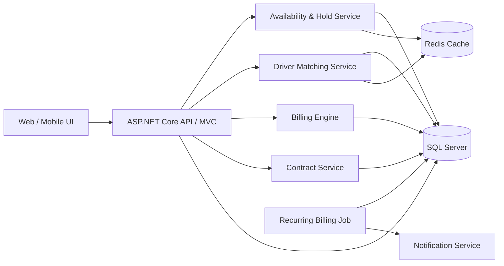
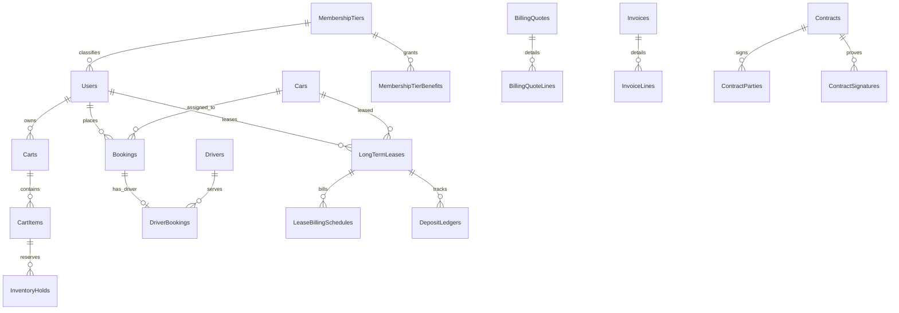
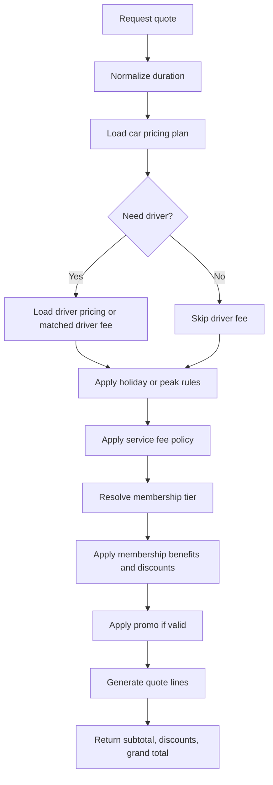

# Car Rental Platform - System Design

## 1. Mục tiêu thiết kế

Nền tảng cần hỗ trợ đồng thời:

- Thuê ngắn hạn theo giờ/ngày.
- Thuê dài hạn theo tháng, có đặt cọc trước `X` tháng và thu tiền định kỳ.
- Đặt nhiều xe trong một giỏ hàng.
- Tùy chọn thuê kèm tài xế với cơ chế ghép nối theo lịch trống.
- Hợp đồng điện tử cho khách thuê, tài xế và đối tác cung cấp xe.
- Billing engine linh hoạt, có membership tiers và khả năng audit.

Hệ thống hiện tại đang là ASP.NET Core MVC + EF Core + SQL Server. Thiết kế bên dưới ưu tiên:

- Có thể mở rộng dần từ schema hiện có.
- Chịu được concurrent booking.
- Tách rõ dữ liệu vận hành, dữ liệu tính giá và dữ liệu audit.

## 2. Kiến trúc logic đề xuất



## 3. Bounded contexts

### 3.1 Search & Availability

- Tìm xe trống theo khu vực, khung giờ, loại xe.
- Truy vấn tài nguyên khả dụng: xe, tài xế, lịch inspection, bảo trì.
- Dùng cache cho danh sách xe trống theo time bucket.

### 3.2 Cart & Booking

- Cho phép một user thêm nhiều xe vào giỏ.
- Mỗi cart item tạo `hold` tạm thời cho xe, và có thể tạo `hold` cho tài xế nếu người dùng bật tùy chọn tài xế.
- Khi checkout thành công, hold chuyển thành booking confirmed.

### 3.3 Long-term Lease

- Hỗ trợ inspection trước khi ký.
- Hỗ trợ cọc trước nhiều tháng.
- Tạo billing schedule theo tháng.

### 3.4 Billing & Membership

- Chuẩn hóa báo giá thành `quote` và `quote lines`.
- Mọi khoản tiền đều có line item và snapshot chính sách.
- Membership được áp vào quote để đảm bảo truy vết lịch sử giá.

### 3.5 Contract & Compliance

- Hợp đồng điện tử có version, trạng thái ký, file render PDF, chữ ký, audit log.
- Hỗ trợ `Customer Rental Contract`, `Driver Contract`, `Partner Contract`.

## 4. Database design

Thiết kế chia thành 2 lớp:

- `Current schema`: các bảng đang có thể tái sử dụng.
- `Proposed extension`: các bảng nên bổ sung để đáp ứng nghiệp vụ mới.

### 4.1 Bảng lõi hiện có nên giữ lại

| Table | Vai trò | Trường quan trọng |
| --- | --- | --- |
| `Users` | Khách hàng, admin, staff, partner | `UserID`, `Role`, `MembershipTierID`, `TotalSpending`, `LoyaltyPoints` |
| `Cars` | Danh mục xe | `CarID`, `CarTypeID`, `LocationID`, `PricePerHour`, `PricePerDay`, `DefaultDeposit`, `OwnerID`, `CommissionRate` |
| `Drivers` | Hồ sơ tài xế | `DriverID`, `LicenseType`, `DailyRate`, `HourlyRate`, `IsAvailable`, `IsApproved`, `Rating`, `TotalTrips`, `LocationID` |
| `Bookings` | Đơn thuê | `BookingID`, `UserID`, `CarID`, `StartDate`, `EndDate`, `TotalPrice`, `BookingStatusID`, `DepositAmount`, `ContractTypeID` |
| `DriverBookings` | Gán tài xế cho booking | `DriverBookingID`, `BookingID`, `DriverID`, `DriverFee`, `Status` |
| `MembershipTiers` | Hạng thành viên | `MembershipTierID`, `Name`, `MinSpending`, `DiscountPercent`, `FreeDeliveryKm`, `ExtraFreeHours` |
| `Payments` | Giao dịch thanh toán | `PaymentID`, `BookingID`, `Amount`, `PaymentMethod`, `PaymentStatus`, `PaymentDate` |
| `DigitalContracts` | Snapshot hợp đồng số hiện có | `DigitalContractID`, `ContractNo`, `BookingID`, trạng thái ký |
| `RentalContracts` | Hợp đồng giao nhận/thuê hiện tại | `ContractID`, `BookingID`, `BasePrice`, `FinalPrice` |
| `ContractTypes` | Kiểu hợp đồng | `ContractTypeID`, `Name`, `Description` |
| `HolidayPricings` | Phụ thu dịp đặc biệt | `HolidayPricingID`, `StartDate`, `EndDate`, `PriceMultiplier` |

### 4.2 Bảng mới đề xuất cho Cart & Hold

| Table | Vai trò | Trường chính |
| --- | --- | --- |
| `Carts` | Header giỏ hàng | `CartID`, `UserID`, `Status`, `Currency`, `ExpiresAt`, `CreatedAt`, `CheckoutAt` |
| `CartItems` | Mỗi xe trong giỏ | `CartItemID`, `CartID`, `CarID`, `StartAt`, `EndAt`, `RentalMode`, `DurationMinutes`, `NeedDriver`, `QuoteID`, `Status` |
| `InventoryHolds` | Lock tạm thời cho xe/tài xế | `HoldID`, `ResourceType`, `ResourceID`, `CartItemID`, `BookingID`, `StartAt`, `EndAt`, `HoldToken`, `Status`, `ExpiresAt`, `CreatedBy` |
| `HoldAuditLogs` | Audit lock/release/expire | `HoldAuditLogID`, `HoldID`, `Action`, `Reason`, `CreatedAt`, `PayloadJson` |

`ResourceType` nên là enum:

- `Car`
- `Driver`
- `InspectionSlot`

Ràng buộc quan trọng:

- `CHECK (StartAt < EndAt)`
- index: `(ResourceType, ResourceID, StartAt, EndAt, Status, ExpiresAt)`
- unique filtered index cho `HoldToken` khi `Status = 'Active'`

### 4.3 Bảng mới cho lịch khả dụng và matching tài xế

| Table | Vai trò | Trường chính |
| --- | --- | --- |
| `DriverShifts` | Lịch làm việc định kỳ | `DriverShiftID`, `DriverID`, `DayOfWeek`, `StartTime`, `EndTime`, `IsRecurring`, `EffectiveFrom`, `EffectiveTo` |
| `DriverTimeOffs` | Nghỉ phép/bận | `DriverTimeOffID`, `DriverID`, `StartAt`, `EndAt`, `Reason`, `Status` |
| `DriverServiceAreas` | Khu vực hoạt động | `DriverServiceAreaID`, `DriverID`, `LocationID`, `CoverageKm`, `Priority` |
| `DriverMatchSnapshots` | Kết quả chấm điểm ứng viên | `DriverMatchSnapshotID`, `CartItemID`, `DriverID`, `Score`, `EtaMinutes`, `ReasonCodes`, `CreatedAt` |
| `DriverStatusHistories` | Lịch sử trạng thái hoạt động | `DriverStatusHistoryID`, `DriverID`, `OldStatus`, `NewStatus`, `ChangedAt`, `ChangedBy` |

Đề xuất mở rộng bảng `DriverBookings`:

- thêm `ReservedFrom`
- thêm `ReservedTo`
- thêm `MatchScore`
- thêm `ServiceAreaLocationID`
- thêm `ActualStartAt`, `ActualEndAt`

### 4.4 Bảng mới cho Inspection & thuê dài hạn

| Table | Vai trò | Trường chính |
| --- | --- | --- |
| `InspectionRequests` | Yêu cầu xem xe | `InspectionRequestID`, `UserID`, `CarID`, `PreferredAt`, `Status`, `Source`, `Notes` |
| `InspectionAppointments` | Lịch hẹn inspection | `InspectionAppointmentID`, `InspectionRequestID`, `ScheduledAt`, `AssignedStaffID`, `LocationID`, `Status` |
| `InspectionReports` | Kết quả kiểm tra xe | `InspectionReportID`, `InspectionAppointmentID`, `CarConditionScore`, `Odometer`, `FuelLevel`, `BatteryLevel`, `ChecklistJson`, `Conclusion`, `SignedAt` |
| `LongTermLeases` | Header hợp đồng thuê dài hạn | `LongTermLeaseID`, `UserID`, `CarID`, `StartDate`, `EndDate`, `MonthlyRent`, `DepositMonths`, `BillingDay`, `AutoPayEnabled`, `Status` |
| `LeaseBillingSchedules` | Lịch thu tiền từng kỳ | `LeaseBillingScheduleID`, `LongTermLeaseID`, `InstallmentNo`, `CoverageFrom`, `CoverageTo`, `DueDate`, `Amount`, `Status`, `InvoiceID` |
| `DepositLedgers` | Sổ cái tiền cọc | `DepositLedgerID`, `LongTermLeaseID`, `EntryType`, `Amount`, `ReferenceNo`, `OccurredAt`, `Note` |

`EntryType` trong `DepositLedgers`:

- `DepositReceived`
- `DepositApplied`
- `DepositRefunded`
- `DepositDeductedPenalty`

### 4.5 Bảng mới cho Billing Engine

| Table | Vai trò | Trường chính |
| --- | --- | --- |
| `PricingPlans` | Bảng giá đầu vào | `PricingPlanID`, `ResourceType`, `ResourceID`, `RateUnit`, `BaseRate`, `MinDuration`, `EffectiveFrom`, `EffectiveTo`, `Status` |
| `ServiceFeePolicies` | Chính sách phí dịch vụ | `ServiceFeePolicyID`, `Name`, `FeeType`, `FeeValue`, `MinFee`, `MaxFee`, `ApplicableScope`, `EffectiveFrom`, `EffectiveTo` |
| `BillingQuotes` | Header báo giá | `QuoteID`, `UserID`, `CartID`, `Channel`, `Currency`, `Subtotal`, `ServiceFee`, `DriverFee`, `MembershipDiscount`, `PromoDiscount`, `GrandTotal`, `PricingSnapshotJson`, `ExpiresAt` |
| `BillingQuoteLines` | Chi tiết từng dòng giá | `QuoteLineID`, `QuoteID`, `LineType`, `RefType`, `RefID`, `Description`, `Quantity`, `UnitPrice`, `Amount`, `MetadataJson` |
| `Invoices` | Hóa đơn chính thức | `InvoiceID`, `CustomerID`, `BookingID`, `LongTermLeaseID`, `InvoiceNo`, `IssueDate`, `DueDate`, `Subtotal`, `DiscountTotal`, `TaxTotal`, `GrandTotal`, `Status` |
| `InvoiceLines` | Dòng hóa đơn | `InvoiceLineID`, `InvoiceID`, `LineType`, `Description`, `Amount`, `MetadataJson` |
| `PaymentTransactions` | PSP/payment gateway transaction | `PaymentTransactionID`, `InvoiceID`, `Provider`, `ProviderTxnRef`, `Amount`, `Status`, `RequestedAt`, `CompletedAt`, `RawPayloadJson` |

`LineType` gợi ý:

- `BaseRental`
- `DriverFee`
- `ServiceFee`
- `DeliveryFee`
- `Deposit`
- `MembershipDiscount`
- `PromotionDiscount`
- `HolidaySurcharge`
- `Penalty`

### 4.6 Bảng mới cho Membership

| Table | Vai trò | Trường chính |
| --- | --- | --- |
| `MembershipTierBenefits` | Đặc quyền theo hạng | `BenefitID`, `MembershipTierID`, `BenefitType`, `BenefitValue`, `MaxCap`, `MetadataJson` |
| `MembershipTierHistories` | Lịch sử thay đổi hạng | `TierHistoryID`, `UserID`, `OldTierID`, `NewTierID`, `QualifiedBySpend`, `ChangedAt` |
| `LoyaltyTransactions` | Cộng/trừ điểm | `LoyaltyTransactionID`, `UserID`, `ReferenceType`, `ReferenceID`, `Points`, `Direction`, `CreatedAt` |

### 4.7 Bảng mới cho Contract Engine

| Table | Vai trò | Trường chính |
| --- | --- | --- |
| `Contracts` | Header hợp đồng dùng chung | `ContractID`, `ContractNo`, `ContractTypeID`, `SubjectType`, `SubjectID`, `Status`, `EffectiveFrom`, `EffectiveTo`, `VersionNo`, `TemplateCode`, `RenderedFileUrl` |
| `ContractParties` | Bên ký | `ContractPartyID`, `ContractID`, `PartyRole`, `PartyType`, `PartyRefID`, `PartyNameSnapshot`, `PartyEmailSnapshot`, `PartyPhoneSnapshot` |
| `ContractSignatures` | Chữ ký điện tử | `ContractSignatureID`, `ContractID`, `ContractPartyID`, `SignedAt`, `SignatureProvider`, `SignatureHash`, `IpAddress` |
| `ContractStatusLogs` | Audit trạng thái hợp đồng | `ContractStatusLogID`, `ContractID`, `OldStatus`, `NewStatus`, `ChangedAt`, `ChangedBy`, `Reason` |

`ContractTypeID` nên map tối thiểu:

- `CustomerRental`
- `LongTermLease`
- `DriverContract`
- `PartnerContract`

## 5. Quan hệ dữ liệu chính



## 6. Luồng xử lý dữ liệu

### 6.1 Luồng cart + concurrent hold

1. User chọn xe, thời gian, địa điểm nhận/trả, tùy chọn `NeedDriver`.
2. Frontend gọi `POST /api/carts/{cartId}/items`.
3. Backend normalize timezone, validate `StartAt < EndAt`, tính `DurationMinutes`.
4. Backend mở transaction `SERIALIZABLE` hoặc dùng truy vấn kiểm tra overlap với `UPDLOCK, HOLDLOCK`.
5. Kiểm tra bảng `InventoryHolds` và `Bookings` xem có resource nào bị overlap trong đoạn thời gian đó.
6. Nếu xe trống, tạo `CartItem`.
7. Tạo `InventoryHold` cho xe với TTL, ví dụ `ExpiresAt = now + 10 phút`.
8. Nếu `NeedDriver = true`, gọi driver matching service:
   - lọc tài xế đã duyệt, đủ loại bằng, đúng khu vực.
   - loại bỏ tài xế có `DriverBookings`, `DriverTimeOffs`, `InventoryHolds` bị overlap.
   - chấm điểm theo `ETA`, `Rating`, `TotalTrips`, `HourlyRate`, `working-hours limit`.
9. Nếu có tài xế phù hợp, tạo thêm `InventoryHold` cho tài xế và lưu `DriverMatchSnapshot`.
10. Gọi billing engine tạo `BillingQuote`.
11. Trả về cart item + quote + thời gian còn lại của hold.

Khi checkout:

1. Backend re-check hold còn hiệu lực.
2. Convert `InventoryHold` sang `Booking` + `DriverBooking`.
3. Tạo `Invoice` hoặc `PaymentTransaction`.
4. Đổi `InventoryHold.Status` thành `Committed`.
5. Sau khi thanh toán thành công, booking thành `Confirmed`.

Khi hết TTL:

- Background job chuyển `InventoryHold.Status` sang `Expired`.
- Cache availability bị invalidation theo `ResourceID`.

### 6.2 Luồng matching xe + tài xế

Điều kiện lọc cứng:

- Xe và tài xế cùng khả dụng trong khoảng thời gian thuê.
- `Driver.IsApproved = true`.
- `Driver.LicenseType` phải đáp ứng loại xe.
- Tài xế thuộc khu vực phục vụ phù hợp với `PickupLocation`.
- Không vượt quá số giờ làm việc tối đa trong ngày.

Điểm ưu tiên đề xuất:

`score = (rating * 0.35) + (trip_reliability * 0.20) + (eta_score * 0.20) + (cost_score * 0.15) + (partner_priority * 0.10)`

Trong đó:

- `eta_score`: càng gần điểm đón càng cao.
- `trip_reliability`: tỷ lệ hoàn thành, ít hủy chuyến.
- `cost_score`: tài xế rẻ hơn được cộng điểm nhưng không nên lấn át chất lượng.

### 6.3 Smart time filter

Frontend:

1. User chọn `date`, `startTime`, `endTime`.
2. FE tính `durationMinutes = end - start`.
3. FE hiển thị nhãn động:
   - `60 phút -> 1 giờ thuê`
   - `180 phút -> 3 giờ thuê`
   - `1440 phút -> 1 ngày thuê`
   - `>= 28 ngày -> Gợi ý gói tháng`
4. FE gửi cả `StartAt`, `EndAt`, `DurationMinutes`, `RentalModeCandidate`.

Backend:

1. Parse timezone thống nhất.
2. Nếu user chọn mốc `end < start`, quy tắc rõ ràng:
   - hoặc reject.
   - hoặc hiểu là qua ngày hôm sau nếu sản phẩm cho phép.
3. Validate min/max rental duration theo `PricingPlan`.
4. Trả lại response chuẩn hóa:
   - `normalizedDurationMinutes`
   - `durationLabel`
   - `recommendedRentalMode`
   - `availableDurationOptions`

API response mẫu:

```json
{
  "startAt": "2026-04-08T05:00:00+07:00",
  "endAt": "2026-04-08T06:00:00+07:00",
  "normalizedDurationMinutes": 60,
  "durationLabel": "1 giờ thuê",
  "recommendedRentalMode": "Hourly",
  "availableDurationOptions": [
    { "value": 60, "label": "1 giờ thuê" },
    { "value": 120, "label": "2 giờ thuê" },
    { "value": 180, "label": "3 giờ thuê" }
  ]
}
```

### 6.4 Luồng tính tiền



Pseudo logic:

```text
base_rental = select_rate(car, duration, rental_mode)
driver_fee = need_driver ? select_driver_rate(driver_or_policy, duration, rental_mode) : 0
service_fee = compute_service_fee(base_rental + driver_fee, service_fee_policy)
membership_discount = compute_membership_discount(user_tier, base_rental, driver_fee, service_fee)
promo_discount = compute_promo_discount(promo, quote_context)
grand_total = base_rental + driver_fee + service_fee - membership_discount - promo_discount
```

Quy tắc kỹ thuật:

- Không tính trực tiếp vào `Bookings.TotalPrice` khi user còn ở cart.
- Luôn lưu `BillingQuote` trước, rồi mới snapshot vào booking/invoice khi checkout.
- Mọi discount phải có line item riêng để audit.

### 6.5 Luồng thuê dài hạn trả tiền hàng tháng

1. User chọn xe dài hạn và gửi yêu cầu inspection.
2. Hệ thống tạo `InspectionRequest`.
3. Staff xác nhận lịch, tạo `InspectionAppointment`.
4. Sau khi inspection hoàn tất, staff lưu `InspectionReport`.
5. User đồng ý thuê, hệ thống tạo `LongTermLease`:
   - `MonthlyRent`
   - `DepositMonths = X`
   - `BillingDay`
   - `StartDate`, `EndDate`
6. Billing engine tạo:
   - `Invoice` cho khoản cọc ban đầu.
   - `DepositLedger(DepositReceived)`.
   - `LeaseBillingSchedules` cho toàn bộ các kỳ tháng sau.
7. Contract service render `LongTermLease contract`.
8. Hai bên ký điện tử, contract sang `Active`.
9. Job hàng ngày quét `LeaseBillingSchedules`:
   - `T-3 ngày`: gửi nhắc.
   - `Đến hạn`: tạo invoice hoặc auto charge.
   - `Quá hạn`: chuyển `Overdue`, gửi cảnh báo, có thể khóa gia hạn.
10. Khi user thanh toán một kỳ:
   - cập nhật `PaymentTransactions`.
   - cập nhật `Invoices.Status = Paid`.
   - cập nhật `LeaseBillingSchedules.Status = Paid`.
11. Khi kết thúc hợp đồng:
   - đối soát hư hỏng/phạt.
   - quyết toán cọc qua `DepositLedgers`.

## 7. Billing engine chi tiết

### 7.1 Rental mode

Gợi ý enum:

- `Hourly`
- `Daily`
- `Monthly`

Quy tắc mapping:

- `< 24 giờ`: ưu tiên `Hourly`.
- `1-27 ngày`: ưu tiên `Daily`.
- `>= 28 ngày`: ưu tiên `Monthly`.

### 7.2 Công thức giá chuẩn

`Total = BaseRental + DriverFee + ServiceFee + HolidaySurcharge + DeliveryFee - MembershipDiscount - PromoDiscount`

Trong đó:

- `BaseRental`: theo `PricingPlans`.
- `DriverFee`: theo tài xế được match hoặc policy tài xế mặc định.
- `ServiceFee`: flat hoặc percent.
- `MembershipDiscount`: dựa vào tier hiện tại và `MembershipTierBenefits`.

### 7.3 Auto-recognition membership tier

Cron hoặc domain event sau mỗi booking completed:

1. Cập nhật `Users.TotalSpending`.
2. So sánh với `MembershipTiers.MinSpending`.
3. Chọn tier cao nhất mà user đạt ngưỡng.
4. Nếu tier thay đổi, ghi `MembershipTierHistories`.

Pseudo:

```text
new_tier = highest tier where MinSpending <= user.TotalSpending
if new_tier != user.MembershipTierID:
    write MembershipTierHistory
    update user.MembershipTierID
```

## 8. Contract flow

### 8.1 Driver Contract

Flow:

1. Driver onboarded.
2. Admin duyệt hồ sơ.
3. System tạo `Contract` loại `DriverContract`.
4. Parties:
   - Platform
   - Driver
5. Driver ký, admin ký.
6. Contract `Active`.
7. Khi tài xế bị khóa hoặc hết hạn giấy tờ, contract chuyển `Suspended` hoặc `Expired`.

### 8.2 Partner Contract

Flow:

1. Partner đăng ký cung cấp xe.
2. Platform thẩm định giấy tờ xe/pháp lý.
3. System tạo `Contract` loại `PartnerContract`.
4. Link contract với các xe mà partner sở hữu.
5. Sau khi ký xong, xe mới được publish.

Trạng thái contract gợi ý:

- `Draft`
- `PendingApproval`
- `SentForSignature`
- `PartiallySigned`
- `Active`
- `Suspended`
- `Expired`
- `Terminated`

## 9. Seeder dữ liệu test cho Driver

Kịch bản dữ liệu tối thiểu cần có:

- Driver mới, chưa duyệt.
- Driver đã duyệt, đang rảnh.
- Driver đang bận do có booking active.
- Driver rating cao nhưng giá cao.
- Driver rating trung bình nhưng ETA gần.
- Driver bằng `B2`, `C`, `D`.
- Driver có lịch sử completed, cancelled, pending.
- Driver có `IsAvailable = false`.

Dataset nên bao phủ:

- `Drivers`
- `DriverBookings`
- `Bookings`
- `Users`
- `Cars`

Các metric nên seed:

- `Rating`: từ `3.8` đến `4.9`
- `TotalTrips`: từ `0` đến `250`
- `ExperienceYears`: từ `1` đến `12`
- `LicenseType`: `B2`, `C`, `D`

## 10. Indexing, concurrency, consistency

### 10.1 Index quan trọng

- `Bookings(CarID, StartDate, EndDate, BookingStatusID)`
- `DriverBookings(DriverID, ReservedFrom, ReservedTo, Status)`
- `InventoryHolds(ResourceType, ResourceID, StartAt, EndAt, Status, ExpiresAt)`
- `LeaseBillingSchedules(LongTermLeaseID, DueDate, Status)`
- `Contracts(ContractTypeID, SubjectType, SubjectID, Status)`

### 10.2 Concurrent booking

Khuyến nghị mạnh:

- Dùng `InventoryHolds` làm nguồn sự thật cho lock tạm thời.
- Re-check overlap ở bước checkout.
- Dùng `rowversion` cho `Bookings`, `CartItems`, `InventoryHolds`.
- Idempotency key cho API `checkout`, `payment callback`, `contract sign callback`.

### 10.3 Cache

Cache theo key:

- `available-cars:{location}:{date-bucket}:{duration-bucket}`
- `available-drivers:{location}:{date-bucket}:{duration-bucket}`

Cache invalidation khi:

- booking created/confirmed/cancelled
- hold created/expired
- maintenance created
- driver shift/time off changed

## 11. Tối ưu và mở rộng đề xuất

### 11.1 Availability cache + bucketed search

- Cache danh sách xe/tài xế trống theo block thời gian 30 hoặc 60 phút.
- Giảm query overlap nặng khi traffic cao.

### 11.2 Outbox pattern cho notification/payment

- Ghi event vào `OutboxEvents` trong cùng transaction với booking/payment.
- Worker riêng gửi email, SMS, webhook.
- Tránh mất event khi transaction thành công nhưng gửi thông báo thất bại.

### 11.3 Recurring billing worker riêng

- Tách job lập lịch thu tiền khỏi request path.
- Hỗ trợ retry, exponential backoff, dead-letter cho charge thất bại.

### 11.4 Quote snapshot versioning

- Mỗi báo giá lưu `PricingSnapshotJson`.
- Khi policy đổi giữa lúc user thêm giỏ và lúc thanh toán, hệ thống so sánh snapshot để cảnh báo thay đổi giá.

### 11.5 Fraud & abuse controls

- Hạn chế số hold đồng thời mỗi user.
- Blacklist hoặc score rủi ro cho tài khoản hủy nhiều lần.
- Rate limit checkout và payment callback.

### 11.6 Reporting schema

- Tách bảng tổng hợp BI theo ngày/tháng:
  - utilization per car
  - fill-rate tài xế
  - overdue invoice rate
  - membership conversion

## 12. Đề xuất triển khai theo pha

### Phase 1

- `Carts`, `CartItems`, `InventoryHolds`
- `BillingQuotes`, `BillingQuoteLines`
- API add-to-cart, refresh hold, checkout

### Phase 2

- `DriverShifts`, `DriverTimeOffs`, matching score
- Quote có `DriverFee`
- Availability cache

### Phase 3

- `InspectionRequests`, `InspectionAppointments`, `InspectionReports`
- `LongTermLeases`, `LeaseBillingSchedules`, `DepositLedgers`

### Phase 4

- `Contracts`, `ContractParties`, `ContractSignatures`, `ContractStatusLogs`
- Tự động recurring billing + nhắc nợ

