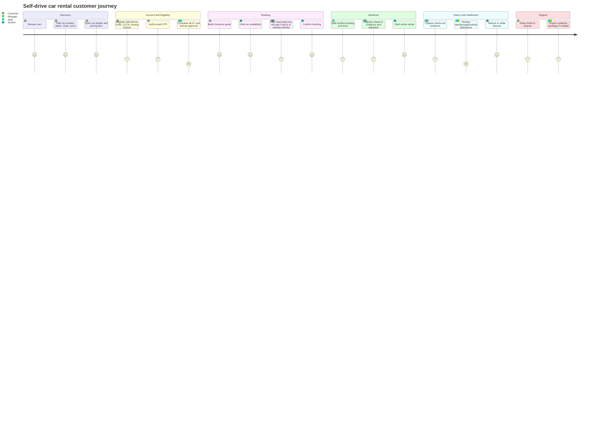

# Customer Journey Diagram

Updated: 2026-05-19

## Evidence Notes

- Pricing display and checkout now share `ISelfDrivePricingService`.
- Handover now requires booking status guards and area/role authorization.
- Production journey still needs browser, eKYC sandbox, PayOS webhook, and staging evidence.
